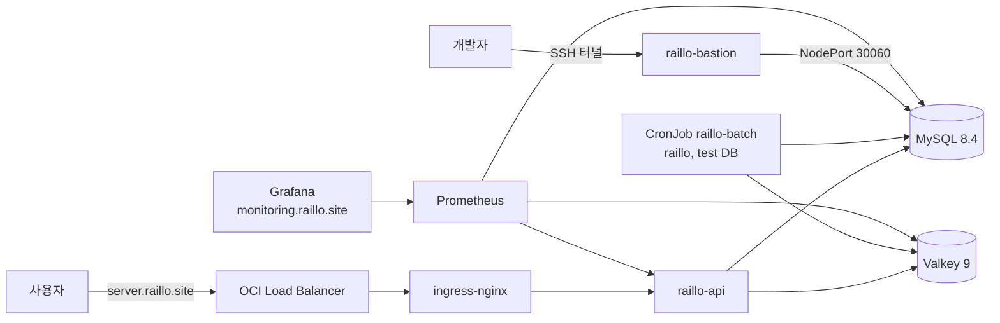

# 인프라

## 하는 일

- 코드를 빌드하고 테스트해 운영 클러스터에 배포한다.
- 운영 클러스터(OKE)에서 API, Batch, MySQL, Valkey, 모니터링을 돌린다.
- 로컬, 테스트, 부하 테스트 환경을 제공한다.

매니페스트는 `k8s/oke/`, 워크플로는 `.github/workflows/`에 있다.

## 구성



- 운영은 Oracle Cloud의 OKE(Kubernetes)에 있다. 노드는 `raillo-node: app`(API, Ingress)과 `raillo-node: data`(MySQL, Valkey) 두 종류다.
- MySQL과 Valkey는 클러스터 안의 StatefulSet이다. 관리형 DB가 아니다.
- `k8s/eks/`는 이전 AWS EKS 매니페스트다. 지금 배포에 쓰지 않는다.

## 환경

| 환경 | 프로파일 | DB, Redis | 용도 |
|---|---|---|---|
| 로컬 실행 | `dev` (기본값) | `.env`의 `DB_URL`, Valkey는 `compose.yaml`이 자동 기동 | 개발 |
| 테스트 | `test` | Testcontainers (MySQL 8.4.10, Valkey 9) | `./gradlew test` |
| 부하 테스트 | `dev` | `compose-test.yaml` (MySQL, Valkey, WireMock, Prometheus, Grafana) | k6, `qa/scripts/bootstrap-test-env.sh` |
| 운영 | `prod` (이미지에 고정) | OKE의 MySQL, Valkey | 서비스 |

- `dev`는 `ddl-auto: update`라 테이블을 만든다. `prod`는 `validate`라 테이블이 없으면 뜨지 않는다.
- 모든 시각은 한국 시간이다. 이미지가 `TZ=Asia/Seoul`과 `-Duser.timezone=Asia/Seoul`로 고정한다.

## 배포

1. `develop`에 push하면 `Build and Test with Gradle`이 `./gradlew build`를 돌린다. PR도 같은 검사를 받는다.
2. 그 워크플로가 push에서 성공하면 `Build ARM64 images and deploy to OKE`가 시작한다. **승인 단계 없이 운영에 배포된다.**
3. `raillo-api`, `raillo-batch` 이미지를 ARM64로 빌드해 GHCR에 `latest`와 `sha-{커밋}` 태그로 올린다.
4. `k8s/oke/api-server/`, `k8s/oke/batch/` 매니페스트의 이미지를 `sha-{커밋}`으로 바꿔 `kubectl apply` 한다.
5. `raillo-api` rollout이 끝나기를 기다린다. 롤링 업데이트라 새 파드가 Ready가 된 뒤 기존 파드를 내린다. CronJob은 다음 실행부터 새 이미지를 쓴다.

- 규칙
  - 배포는 한 번에 하나만 돈다(`concurrency: raillo-oke-production`).
  - **ConfigMap(`raillo-config`), Secret(`raillo-secrets`, `ghcr-secret`), MySQL, Valkey, 모니터링은 배포가 건드리지 않는다.** 바꾸려면 직접 `kubectl apply` 한다. 배포는 두 Secret과 ConfigMap이 `api-server`, `batch` 네임스페이스에 있는지만 확인한다.
  - 수동 배포는 `workflow_dispatch`로 `develop`에서만 할 수 있다.

## 클러스터 리소스

| 네임스페이스 | 리소스 | 설정 |
|---|---|---|
| `api-server` | `raillo-api` Deployment, Service, Ingress | 1대, `RollingUpdate`(`maxSurge` 1, `maxUnavailable` 0), CPU request 500m, 메모리 2Gi, 힙은 메모리의 75%. 요청은 8080, 관리 엔드포인트는 8081 |
| `batch` | `train-daily-schedule`, `delete-expired-members` CronJob (`raillo` DB), `-test`가 붙은 같은 CronJob (`test` DB) | 03:00, 04:00, test는 03:30, 04:30 (한국 시간), 동시 실행 금지. Job은 [batch](../batch/README.md) |
| `mysql` | `mysql` StatefulSet, PVC 50Gi | `mysql-admin` NodePort 30060으로 클러스터 밖 접속 |
| `valkey` | `valkey` StatefulSet | AOF(`everysec`), RDB 없음, `maxmemory 2gb`, `noeviction` |
| `monitoring` | Prometheus, Grafana, kube-state-metrics, node-exporter, mysql-exporter, valkey-exporter | Grafana는 `monitoring.raillo.site` |
| (클러스터) | ingress-nginx, cert-manager `raillo-issuer` | OCI Load Balancer, Let's Encrypt |

- 규칙
  - **CPU는 request만 두고 limit을 두지 않는다. 메모리는 limit을 둔다.** 노드 CPU가 남으면 request보다 더 쓰고, 모자라면 request 비율로 나눠 받는다. OKE가 관리하는 `kube-system` 파드는 건드리지 않는다.
  - API 롤링 업데이트 중에는 app 노드에 API 파드가 2대 뜬다. app 노드의 CPU request 여유가 API request(500m)보다 작으면 새 파드가 Pending에 걸려 배포가 타임아웃된다. app 노드에 파드를 추가하거나 request를 올릴 때 확인한다.
  - `test` CronJob은 `env`의 `DB_URL`로 `raillo-config`의 값을 덮는다. Redis는 운영 Valkey를 가리키므로 열차 캐시를 적재하지 않는 Job만 돌린다.
  - Valkey가 `noeviction`이므로 메모리가 차면 쓰기가 실패한다. 예약과 열차 캐시 키를 지워서 공간을 만들지 않는다.
  - actuator는 관리 포트 8081에서만 뜬다. Service와 Ingress는 8080만 노출하므로 밖에서 actuator에 닿지 않는다. kubelet 프로브와 Prometheus는 파드 IP로 8081에 직접 붙는다.
  - 프로브는 `/actuator/health/liveness`(startup, liveness)와 `/actuator/health/readiness`다. 둘 다 DB, Redis 같은 의존성을 보지 않는다.

## 접속

운영 MySQL은 bastion을 거쳐 SSH 터널로 붙는다.

```bash
ssh -f -N -L 13306:10.0.10.198:30060 raillo-bastion
```

`jdbc:mysql://127.0.0.1:13306/{DB}`로 접속한다. 한 MySQL에 DB가 여러 개 있으므로 접속 전에 DB 이름을 확인한다. 테이블 초기화는 `/db-reset`을 쓴다.

## 에이전트 접근 제한

AI 에이전트(Claude Code)는 운영 클러스터와 DB를 **조회만** 한다. 클러스터 변경, DB 쓰기, 터널 열기는 사람이 터미널에서 직접 한다. 사람이 치는 명령은 막지 않는다. 예외는 `/db-reset`이다. 사용자가 대상과 지울 테이블을 확인하고 승인하면 에이전트가 `.env`의 DB에 실행한다.

| 파일 | 역할 |
|---|---|
| `.claude/hooks/guard-bash.sh` | 셸 명령을 실행 전에 검사해 막는다. Bash, Monitor, 터미널 패널 실행 도구에 걸린다 |
| `.claude/hooks/require-tests.sh` | 테스트를 통과하지 않은 커밋의 `git push`, `gh pr create`를 막는다 |
| `.claude/hooks/run-tests.sh` | `./gradlew build`를 돌리고 통과하면 HEAD의 트리 해시를 `.git/raillo-tests-passed`에 기록한다 |
| `.claude/settings.json` | 훅 등록, 조회 명령 자동 허용, `.env*` 읽기 금지, 가드 파일 수정 시 확인 |
| `qa/db-scripts/readonly-query.sh` | `.env`의 DB에 조회 쿼리 하나를 읽기 전용 세션으로 실행한다 |

| 대상 | 허용 | 막음 |
|---|---|---|
| `kubectl` (`k`, `kubecolor`, `oc`) | `get`, `describe`, `logs`, `top`, `events`, `explain`, `api-resources`, `api-versions`, `version`, `cluster-info`, `rollout status/history`, `auth can-i/whoami`, `config current-context/get-contexts/get-clusters/view` | 그 외 동사(`apply`, `delete`, `exec`, `port-forward`, `scale`, `config use-context` 등), Secret 조회, `--raw` |
| `helm` | `list`, `status`, `history`, `version` | 그 외. `get values`는 민감한 값을 출력한다 |
| `oci` | `list`, `get` | 그 외, `secrets`, `vault`, `kms` 서비스 |
| DB | `readonly-query.sh` | `mysql`, `mysqldump`, `mysqladmin`, `mysqlimport`, `mysqlpump`, `mysqlsh`, `mariadb`, `mycli` 직접 실행 |
| 원격 접속 | - | `ssh`, `scp`, `sftp`, `autossh` |
| 환경 파일 | 셸에서 `.env.example`, 검색은 `git grep`과 `rg` | 단어 안에 `.env`가 든 명령(`cat .env`, `python3 -c "open('.env')"` 등), `.gitignore`를 무시하는 검색(재귀 `grep`, `rg -uu`). Read, Edit 도구(Write 포함)는 `.env*` 전체를 막는다 |
| git 훅 | - | `--no-verify`, `commit -n`, `core.hooksPath` 변경 |
| 가드 파일 | 읽기, 실행 | 셸(`sed -i`, `cp`, `mv`, `rm`, 리다이렉트)로 `.claude/settings*.json`, `.claude/hooks/` 수정 |

```bash
qa/db-scripts/readonly-query.sh "SELECT status, COUNT(*) FROM booking GROUP BY status"
```

- 규칙
  - 훅은 명령을 셸처럼 나눠 본다. `;`, `&&`, `|`, `$( )`, 줄 끝 `\`, `if`와 `for` 본문, `bash -c`, `eval`, `xargs`, `find -exec` 뒤의 명령도 검사한다. 따옴표 안의 문자열과 here-document 본문은 셸이 실행할 때만 검사하므로 커밋 메시지에 `kubectl delete`가 있어도 막지 않는다.
  - `readonly-query.sh`는 `SELECT`, `WITH`, `TABLE`, `SHOW`, `DESCRIBE`, `EXPLAIN` 문 하나만 받는다. `INTO`, `FOR UPDATE`, `LOCK IN SHARE MODE`, 백슬래시(mysql 클라이언트 명령), 주석은 거절한다. 세션은 `transaction_read_only = ON`, `max_execution_time` 10초로 연다. 스크립트 검사를 통과한 쓰기(`WITH ... DELETE`)도 MySQL이 `ERROR 1792`로 거절한다.
  - `jq`가 없거나 검사 중 오류가 나면 막는다. macOS 15 이상은 `/usr/bin/jq`가 있다.
  - **실수는 막지만 작정한 우회는 막지 못한다.** 변수에 담은 명령, 에이전트가 직접 쓴 스크립트 안의 명령, `k` 외의 개인 alias는 검사하지 못한다. 개인 설정의 `disableAllHooks`는 훅을 끈다. 로컬 kubeconfig와 `.env` 계정의 권한은 그대로다.
  - 훅을 고치면 `.claude/hooks/guard-bash.test.sh`에 막을 명령과 통과시킬 명령을 함께 추가하고 실행한다.
  - **에이전트는 테스트를 통과한 커밋만 push하고 PR로 올린다.** `require-tests.sh`가 HEAD의 트리 해시를 `run-tests.sh`의 기록과 비교한다. 커밋 해시가 아니라 트리 해시라서 `/tidy-commits`로 이력만 정리하면 다시 돌리지 않아도 된다. `origin/develop` 대비 바뀐 파일이 `*.md`뿐이면 검사하지 않는다.
  - `run-tests.sh`는 커밋하지 않은 변경이 있으면 돌지 않는다. 테스트한 코드와 push할 커밋이 같아야 하기 때문이다. Docker가 없어 돌릴 수 없으면 사용자에게 알리고, push는 사용자가 직접 한다.
  - `require-tests.sh`를 고치면 `.claude/hooks/require-tests.test.sh`를 실행한다.

## 민감한 값 스캔

API 키, 토큰, 비밀번호가 저장소에 올라가는 것을 세 겹으로 막는다.

| 계층 | 막는 지점 | 뚫리는 경우 |
|---|---|---|
| `.gitignore` | `.env*` 추적 | `git add -f` |
| pre-commit 훅 (`.githooks/pre-commit`) | 커밋 | 훅을 켜지 않음, `--no-verify` |
| CI (`secret_scan.yml`) | `develop` push와 PR. 히스토리 전체를 본다 | 억제 설정을 같은 변경에 넣음 |

훅은 클론마다 한 번 켠다. 에이전트는 `core.hooksPath`를 바꿀 수 없으므로 사람이 실행한다.

```bash
brew install gitleaks
git config core.hooksPath .githooks
```

- 규칙
  - 훅은 gitleaks 미설치, 버전 하한 미달, 설정 파일 없음, 실행 실패를 모두 차단으로 처리한다. 검사하지 못한 커밋을 통과시키지 않는다.
  - **훅의 `MIN_VERSION`과 CI의 `GITLEAKS_VERSION`은 같은 값이다.** 올릴 때 둘을 함께 고친다.
  - 오탐이 한 줄이면 `gitleaks:allow` 주석을 단다. 반복되면 `.gitleaks.toml`의 `[[allowlists]]`에 `targetRules`와 `paths`(또는 `regexes`)를 함께 지정해 좁게 넣는다.
  - **`.gitleaksignore`와 `--baseline-path`는 쓰지 않는다.** fingerprint가 커밋 해시에 묶여 히스토리를 고치면 억제가 풀린다. 훅과 CI 모두 `.gitleaksignore`가 있으면 실패한다.
  - Toss 클라이언트 키(`test_ck_`)는 브라우저로 내려가는 공개 값이라 허용한다. 시크릿 키(`sk`, `gsk`)는 허용하지 않고, `toss-secret-key` 규칙이 변수명과 관계없이 접두사로 잡는다.
  - 에이전트는 훅에 막히면 출력의 `File`과 `Line`을 사용자에게 보고한다. 오탐이라고 스스로 판단해 허용 목록을 넓히지 않는다.
  - CI 실패는 배포를 막지 않는다. 머지를 막으려면 브랜치 규칙에서 `Secret Scan`을 필수 체크로 지정한다.
  - 훅이나 `.gitleaks.toml`을 고치면 막혀야 할 문자열과 통과해야 할 문자열로 차단 동작을 확인한다. 판정은 출력 문자열이 아니라 종료 코드로 한다.

## 모니터링

- Prometheus가 `raillo-api`의 8081 `/actuator/prometheus`, MySQL, Valkey, 노드, 컨테이너 지표를 수집한다. relabel이 컨테이너 포트 번호로 거르므로 관리 포트를 바꾸면 `prometheus-configmap.yaml`의 정규식도 바꾼다.
- 로컬 QA 스택(`compose-test.yaml`)에서 호스트의 관리 포트는 8091이다. 호스트 8081은 WireMock이 쓴다.
- Grafana 대시보드는 `grafana-dashboards-configmap.yaml`, 알림 규칙은 `grafana-alerting-configmap.yaml`에 있다. 알림은 Grafana 통합 알림으로 Discord에 보낸다.

| 알림 | 무엇을 보나 |
|---|---|
| raillo-api, Valkey, MySQL 수집 불가 | 수집 대상이 사라짐 |
| raillo-api 파드 재시작 | 재시작 발생 |
| raillo-api 요청 스레드 포화 | 8080 요청 스레드 `busy / config_max` |
| raillo-api 스레드 지표 유실 | 위 포화 규칙이 볼 지표가 사라짐 |
| raillo-api DB 커넥션 획득 실패 | 앱이 실제로 커넥션을 못 얻음 |
| Toss 커넥션 풀 대기, Toss 승인 요청 미전송 | 결제 호출 경로 이상 |
| 결제 수동 확인 대기 | 최근 24시간 안에 수동 확인으로 남은 결제 시도 수. 전체 행이 아니라 창 안의 행을 본다 |
| 결제 복구 지체 | 복구 임계값을 넘겨 진행 중으로 남은 결제 시도 수. severity는 critical이다 |

- 규칙
  - 수집 불가 세 규칙만 `noDataState` 기본값이고 나머지는 `OK`다. 대상이 사라진 것 자체가 신호이기 때문이다.
  - **`grafana-secret`의 `DISCORD_WEBHOOK_URL`을 먼저 넣고 Grafana를 롤아웃한다.** 없으면 프로비저닝이 실패해 Grafana가 기동하지 못한다. Secret에는 다른 키도 있어 `apply`로 덮지 않고 `patch`한다.
  - 모니터링 매니페스트는 배포가 적용하지 않는다. Prometheus는 리로드 엔드포인트가 꺼져 있어 configmap을 적용한 뒤 `rollout restart` 한다. `grafana-alerting` configmap은 `grafana-deployment.yaml`이 마운트하므로 둘을 함께 적용한다.
  - 데이터소스 uid는 `prometheus`로 고정한다. 알림 규칙이 uid로 지목한다. **이름이 같고 uid가 다른 데이터소스가 Grafana DB에 있으면 프로비저닝이 실패해 Grafana가 CrashLoopBackOff에 빠진다.** uid는 갱신으로 바꿀 수 없어 `deleteDatasources`로 지우고 다시 만든다. Grafana DB는 노드의 `/var/lib/raillo/grafana`(hostPath)에 남아 파드를 지워도 그대로다.
  - 스레드 지표는 `server.tomcat.mbeanregistry.enabled: true`일 때만 생긴다. `spring.threads.virtual`을 켜면 `config_max`가 0이 되어 포화 규칙이 의미를 잃는다.

## 설계 결정

### 관리 엔드포인트를 별도 포트로 분리한다
- 맥락: 8080의 요청 스레드가 외부 호출 대기로 모두 묶이면 같은 포트의 헬스 체크도 응답하지 못한다. 그러면 kubelet이 파드를 재시작하는데, 재시작은 외부 지연을 고치지 못하고 진행 중이던 결제만 끊는다.
- 결정: `management.server.port`(8081)로 actuator를 분리한다. Spring Boot가 독립된 커넥터와 스레드 풀을 만든다.
- 결과: 요청 스레드가 포화돼도 프로브는 응답한다. 대신 포화가 재시작이나 `up=0`으로 드러나지 않으므로 스레드 포화 알림으로 따로 본다. 나뉘는 것은 스레드 풀뿐이라 CPU 포화나 긴 GC 정지는 두 포트에 함께 온다.

### 프로브는 의존성을 보지 않는다
- 맥락: 종합 `/actuator/health`는 DB, Redis, 메일 상태를 합산한다. 이를 프로브에 쓰면 의존성이 흔들릴 때마다 파드가 재시작되고, 그 장애는 재시작으로 고쳐지지 않는다.
- 결정: liveness는 livenessState만, readiness도 의존성을 보지 않는다. 의존성 상태는 알림이 다룬다.
- 결과: 파드가 1대인 동안 readiness 때문에 Service에서 빠져 전면 중단되는 일이 없다. 롤링 업데이트는 기동이 끝나면 새 파드를 Ready로 보므로, 새 파드가 DB나 Redis에 붙지 못해도 기존 파드를 내린다. 스케일 아웃하면 readiness 기준을 다시 정한다.

### API는 롤링 업데이트로 무중단 배포한다
- 맥락: `Recreate`는 기존 파드를 먼저 내려 기동이 끝날 때까지(최대 180초) 서비스가 멈춘다. 롤링 업데이트는 두 파드가 잠시 함께 뜨는데, app 노드의 CPU request가 거의 차 있어 API request 1000m으로는 두 번째 파드가 들어가지 못했다.
- 결정: `maxSurge` 1, `maxUnavailable` 0으로 새 파드가 Ready가 된 뒤 기존 파드를 내린다. CPU limit을 없애고 API CPU request를 500m으로 낮춰 두 파드가 app 노드에 들어가게 한다. 내려가는 파드는 preStop 5초 동안 Service에서 빠지고, Spring graceful shutdown(최대 30초)으로 진행 중인 요청을 마친다. `terminationGracePeriodSeconds`는 이 둘보다 긴 45초다.
- 결과: 배포 중에도 요청을 받는다. 잠시 두 인스턴스가 함께 돌지만 결제 Outbox Worker는 `SKIP LOCKED`로 같은 행을 잡지 않는다. request를 낮춘 만큼 노드 CPU가 붐비면 API가 1 CPU를 보장받지 못한다.

### test DB 배치는 열차 캐시를 적재하지 않는다
- 맥락: `test` DB도 운행이 매일 늘어야 한다. 그런데 Batch의 Redis는 운영 Valkey이고, 운행 캐시 키(`{schedule:{id}}:*`)는 운행 ID로 정해져 `raillo`와 `test`의 ID가 겹친다. 그대로 적재하면 운영 예약이 읽는 캐시를 test 데이터로 덮는다.
- 결정: test CronJob은 운행 적재 Step이 없는 `trainDailyScheduleOnly`를 돌린다. 회원 정리는 Redis를 쓰지 않아 같은 Job을 쓴다.
- 결과: test DB의 운행은 늘지만 그 운행의 캐시는 생기지 않는다. test DB로 예약하려면 그 환경의 Redis에 `trainScheduleCacheLoad`를 따로 돌린다.

### 배포는 커밋 SHA 태그로 고정한다
- 맥락: 매니페스트는 `latest`를 가리킨다. `latest`로 apply 하면 매니페스트가 바뀌지 않아 rollout이 일어나지 않고, 어떤 커밋이 떠 있는지 알 수 없다.
- 결정: 배포 때 매니페스트의 이미지를 `sha-{커밋}`으로 바꿔 apply 한다.
- 결과: 배포마다 rollout이 일어나고, 떠 있는 이미지로 커밋을 알 수 있다. 저장소의 매니페스트는 계속 `latest`를 가리키므로 손으로 apply 하면 `latest`가 뜬다.

### API와 Batch는 한 Dockerfile로 빌드한다
- 맥락: 두 앱은 같은 JDK, 같은 시간대, 같은 실행 사용자를 써야 한다.
- 결정: `APP_MODULE` 빌드 인자로 모듈만 고른다. CronJob의 `args`가 `java -jar` 뒤에 붙는다.
- 결과: 실행 환경이 둘로 갈라지지 않는다. Batch에도 `SPRING_PROFILES_ACTIVE=prod`가 들어가지만 Batch에는 프로파일별 설정 파일이 없어 영향이 없다.
