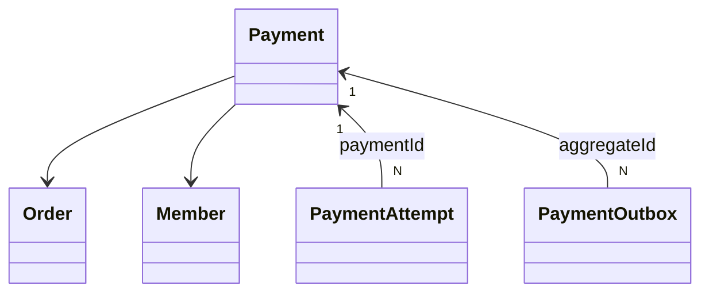

# 결제

## 도메인

- 승객은 예약을 고른 뒤 **결제 준비 → 결제창 → 결제 승인** 순으로 결제한다. 결제사는 토스페이먼츠(Toss)다.
- **결제 준비**
  - 고른 예약이 모두 자기 것이고 살아 있는지, 이미 팔린 좌석과 겹치지 않는지 확인한다.
  - [주문](../order/README.md)과 결제를 결제 대기 상태로 만들고 주문 코드와 금액을 돌려준다.
- **결제창**: 클라이언트가 주문 코드와 금액으로 Toss 결제창을 연다. 승객이 결제하면 Toss가 `paymentKey`를 준다.
- **결제 승인**
  - 클라이언트가 `paymentKey`, 주문 코드, 금액을 보내면 서버가 Toss에 승인을 요청한다.
  - 승인되면 주문이 완료되고 예매와 승차권이 만들어진다.
  - 좌석 점유를 예약에서 예매로 바꾸는 일은 잠시 뒤 [Outbox Worker](../worker/README.md)가 한다.
- 승인 요청은 같은 결제에 여러 번 올 수 있다(새로고침, 재시도). **카드는 한 번만 청구돼야 하고 예매도 한 번만 만들어져야 한다.**
- Toss가 승인했는지 모르는 경우가 있다(타임아웃, Toss 5xx). 이때는 실패로 단정하지 않고, 승객이 다시 요청하면 Toss에 상태를 조회해 맞춘다. 그 사이 예약 TTL이 좌석을 가져가지 않도록 좌석을 붙잡아 둔다.

## 용어

| 한국어 | 영어 | 설명 |
|---|---|---|
| 결제 | Payment | 주문 하나에 대한 결제. 금액과 상태를 가진다 |
| 결제 시도 | PaymentAttempt | Toss에 보내는 승인 요청 하나의 기록. 같은 요청의 재시도는 같은 시도다 |
| 시도 ID | attemptId | 시도를 구분하는 외부 멱등 키. `paymentKey`에서 계산한다 |
| paymentKey | - | Toss가 결제창에서 발급한 결제 식별자 |
| 주문 코드 | orderCode | Toss에 넘기는 주문 번호(`orderId`). 주문의 주문 코드와 같다 |
| 확정 대상 | PaymentConfirmTarget | 확정할 결제를 가리키는 세 값(`paymentKey`, 주문 코드, 금액). DB에서 읽는다 |
| 결과 불명 | - | 요청은 나갔지만 Toss가 승인했는지 모르는 실패 |
| 미전송 | NOT_SENT | 요청이 Toss에 도달하지 않은 것이 확정인 실패 |
| TX A, TX B | - | 승인 시작 트랜잭션과 승인 확정 트랜잭션 |

## 도메인 모델

### [결제]

#### 결제(Payment)
Aggregate Root

- 속성: `member`, `order`, `orderCode`, `amount`, `paymentStatus`, `paymentKey`, `paymentMethod`, `paidAt`, `failedAt`, `cancelledAt`, `refundedAt`, `failureCode`, `failureMessage`
- 행위
  - `static create(member, order)`: 주문의 코드와 금액으로 결제 대기 결제를 만든다
  - `approve(method, paymentKey)`: 결제 완료. Toss가 발급한 `paymentKey`를 저장한다
  - `cancel(reason)`, `refund()`, `fail(code, message)`
- 규칙
  - 결제 대기에서만 승인, 취소, 실패할 수 있다. 결제 완료에서만 환불할 수 있다
  - 같은 주문에 결제 완료된 결제가 있으면 승인하지 않는다
  - `member`, `order`는 DB 외래키를 걸지 않는다
  - `cancel`, `refund`, `fail`을 부르는 곳은 아직 없다. Toss가 승인을 거절해도 결제는 결제 대기로 남고 시도만 실패가 된다

#### 결제 상태(PaymentStatus)
Enum: `PENDING` 결제 대기, `PAID` 결제 완료, `CANCELLED` 결제 취소, `REFUNDED` 환불 완료, `FAILED` 결제 실패

#### 결제 시도(PaymentAttempt)
Entity, Payment N:1 (외래키 없이 `paymentId`)

- 속성: `attemptId`, `attemptType`, `status`, `paymentKey`, `errorCode`, `errorMessage`
- 행위
  - `static startApproval(paymentId, attemptId, paymentKey)`: 진행 중 승인 시도를 만든다
  - `markSucceeded()`, `markFailed(...)`, `markNotSent(...)`, `markReviewRequired(...)`: 진행 중에서만 바뀐다
  - `reopen()`: 미전송을 다시 진행 중으로 되돌린다
- 규칙
  - `attemptId`는 `sha256("apv:" + paymentKey)`다. 클라이언트에게 받지 않는다. 유니크 제약이 있다
  - 시도의 `paymentKey`와 결제, 유형이 요청과 다르면 같은 오류(`PAYMENT_ATTEMPT_REQUEST_MISMATCH`)로 거절한다. 어느 쪽이 다른지는 로그에만 남긴다
  - 요청과의 대조는 잠금 없는 시작 단계에서 한다. 확정(TX B)은 저장된 값으로 비교하므로 `paymentKey` 축이 항상 일치한다. 요청의 `paymentKey`는 `attemptId` 파생과 유니크 제약으로 이미 시도에 묶여 있다
  - `processingOwner`, `processingLeaseUntil`, `nextRetryAt`은 복구 Worker가 선점과 백오프에 쓴다

#### 시도 상태(PaymentAttemptStatus)
Enum

| 상태 | 뜻 | 같은 시도로 다시 승인 요청이 오면 |
|---|---|---|
| `IN_PROGRESS` | Toss 호출 전이거나 결과 불명 | Toss에 상태를 조회해 맞춘다(`PaymentApprovalReconciler`) |
| `SUCCEEDED` | 승인 확정 | Toss 호출 없이 이전 결과를 돌려준다 |
| `FAILED` | Toss가 거절 | 거절한다 |
| `NOT_SENT` | 요청이 Toss에 도달하지 않음 | 같은 시도를 다시 진행 중으로 열고 승인을 다시 보낸다 |
| `REVIEW_REQUIRED` | 승인됐을 수 있어 자동 확정하면 안 됨 | 거절하고 고객센터로 안내한다 |

`REVIEW_REQUIRED`는 종착점이다. 나가는 전이가 없어 자동으로 되살아나지 않는다. 사유는 `errorCode`에 남는다.

| 사유 | 언제 |
|---|---|
| `REVIEW_RESULT_MISMATCH` | Toss 조회 결과가 저장된 주문 코드, 금액, `paymentKey`와 다르다 |
| `REVIEW_PAYMENT_KEY_MISSING` | 시도에 `paymentKey`가 없어 조회조차 못 한다 |
| `REVIEW_SEAT_LOST` | 확정 단계에서 좌석이 이미 다른 예매의 것이다 |
| `REVIEW_DEPARTED` | 확정 단계에서 출발 시각이 지났다 |
| `REVIEW_RECOVERY_TIMEOUT` | 복구 Worker가 최대 대기 시간을 넘기도록 판정하지 못했다 |

`PaymentAttemptType`은 `APPROVAL`, `CANCELLATION`이다. 취소 시도는 아직 쓰지 않는다.

### 도메인 서비스

#### 결제 승인(PaymentConfirmService)

`confirm`은 트랜잭션을 열지 않고 세 단계를 잇는다.

1. **시작** (`PaymentApprovalStarter`, `PaymentAttemptManager`)
   - 주문, 결제 소유자와 금액(요청 = 주문 = 결제)을 확인한다.
   - 같은 `attemptId`의 시도가 있으면 위 표대로 처리한다. 진행 중이면 `PaymentApprovalReconciler`가 Toss를 조회해 판정한다.
   - 없으면 결제 대기인지, 예약이 살아 있는지, 같은 주문에 완료된 결제가 없는지 확인한다.
   - TX A에서 결제를 잠그고 다시 확인한 뒤 진행 중 시도를 커밋한다.
2. **Toss 승인 호출**: DB 트랜잭션 밖에서 한다.
   - 거절(4xx)이면 시도를 실패로 바꾸고 좌석 보호를 푼다.
   - 미전송이면 시도를 미전송으로 바꾼다.
   - 결과 불명이면 진행 중으로 두고 좌석을 붙잡는다.
3. **확정** (`PaymentApprovalFinalizer`, TX B)
   - 결제를 잠그고 시도 상태를 다시 본다.
   - Toss 응답의 금액, `paymentKey`, 주문 코드가 DB에 저장된 값과 같은지 확인한다. 요청은 쓰지 않는다.
   - 출발 시각이 지났는지, 좌석이 다른 예매의 것이 됐는지 잠금 아래에서 다시 본다.
   - 주문 완료, 예매 생성, 결제 완료, 시도 성공, Outbox 행 저장을 한 트랜잭션으로 커밋한다.

- 규칙
  - 확정 단계에서 시도가 이미 `FAILED`면 거절한다. Toss는 승인했는데 기록만 실패인 경우이며, 지금은 감지만 하고 되살릴 경로가 없다
  - 출발이 지났거나 좌석을 빼앗겼으면 확정하지 않고 수동 확인으로 남긴다. 확정은 사유만 실어 중단하고, 시도 마킹과 좌석 해제는 Payment 잠금이 풀린 뒤 `PaymentConfirmService`가 한다
  - `seat_booking`에 좌석, 구간 유니크 제약이 없고 예매 생성도 좌석 충돌을 보지 않는다. 겹침은 결제 준비와 확정 단계의 DB 재검증으로 막으며, 제약 자체는 #280이다

**실패 응답**

| 경우 | 응답 | 클라이언트가 할 일 |
|---|---|---|
| Toss 거절 (4xx) | Toss 상태 코드 그대로 | 실패 안내 |
| 미전송 | 503 `PAYMENT_118` | 바로 다시 시도해도 된다 |
| 결과 불명, 아직 처리 중 | 409 `PAYMENT_113` | 잠시 뒤 같은 요청으로 다시 확인한다. 자동 재시도하지 않는다 |
| 이미 실패한 시도 | 409 `PAYMENT_112` | 새로 결제한다 |
| 수동 확인 대상 | 409 `PAYMENT_117` | 고객센터 |
| 확정 단계에서 시도에 저장된 결제 키가 없음 | 500 `PAYMENT_119` | 다시 시도하지 않는다. 서버 오류이며 운영 확인이 필요하다 |

Toss 호출에는 confirm, query(사용자), query(Worker)별로 서킷 브레이커가 걸려 있다. 회로가 열리면 호출이
나가지 않는데, 이것도 미도달이 확정이므로 새 분류를 만들지 않고 위 표를 그대로 쓴다. confirm은 미전송과
같은 503 `PAYMENT_118`로, query는 결과 불명과 같이 좌석을 유지하고 재조회로 넘어간다.

## 설계 결정

### 승인은 시작, Toss 호출, 확정 세 단계로 나눈다
- 맥락: Toss 호출 중에 서버가 죽거나 응답을 못 받으면, 돈은 나갔는데 아무 기록도 없을 수 있다. Toss 호출을 DB 트랜잭션 안에 두면 그 기록도 함께 롤백된다.
- 결정: Toss를 부르기 전에 진행 중 시도를 별도 트랜잭션(TX A, `REQUIRES_NEW`)으로 먼저 커밋한다. Toss 호출은 트랜잭션 밖에서 하고, 성공하면 확정을 또 다른 트랜잭션(TX B)으로 커밋한다.
- 결과: 어떤 시점에 장애가 나도 진행 중 시도가 남아, 다시 요청하면 Toss 조회로 맞출 수 있다. 확정은 주문, 예매, 결제, 시도, Outbox를 한 번에 커밋하므로 일부만 반영되지 않는다.

### 시도 ID를 `paymentKey`에서 계산하고 유니크 제약으로 멱등성을 보장한다
- 맥락: 같은 결제의 승인 요청이 동시에 또는 반복해서 온다. DB PK는 저장해야 정해지므로, 다시 온 요청이 이전 시도를 찾는 키로 쓸 수 없다.
- 결정: `attemptId = sha256("apv:" + paymentKey)`로 같은 요청이 항상 같은 키를 갖게 하고, `attempt_id`에 유니크 제약을 건다.
- 결과: 동시에 온 두 요청 중 하나만 시도를 만든다. 진 쪽은 유니크 충돌을 받아 기존 시도의 재요청 흐름으로 간다. 취소는 한 결제에 여러 번 일어날 수 있어 `cnl:{paymentKey}:{순번}`으로 구분하도록 준비돼 있다.

### 같은 검증을 세 번 한다
- 맥락: 잠금 없는 사전 검증과 실제 커밋 사이에 다른 요청이 끼어들 수 있다.
- 결정: 시작(잠금 없음)에서 빨리 걸러 Toss 호출을 아끼고, TX A와 TX B에서 결제를 `SELECT FOR UPDATE`로 잠근 뒤 다시 검증한다. 마지막 방어는 `attempt_id` 유니크 제약이다.
- 결과: 동시 요청이 와도 승인과 확정은 한 번씩만 일어난다. 시도 상태를 바꾸는 모든 경로가 결제를 먼저 잠그고 시도를 읽는다. 잠그기 전에 읽으면 먼저 커밋된 성공을 실패로 덮어쓸 수 있다.

### 결과 불명은 실패가 아니라 진행 중으로 남기고 409로 응답한다
- 맥락: Toss 5xx나 타임아웃은 Toss가 승인한 뒤 응답만 실패했을 수 있다. 실패로 처리하거나 5xx를 그대로 내리면, 재시도하는 클라이언트가 승인을 다시 보내 이중 청구가 된다.
- 결정: 결과 불명은 시도를 진행 중으로 두고 재시도를 부르지 않는 409로 응답한다. 같은 요청이 다시 오면 승인을 다시 보내지 않고 Toss에 조회한다. Toss 호출도 조회(GET)만 자동 재시도하고 승인(POST)은 재시도하지 않는다. Toss는 POST에 `Idempotency-Key`를 지원하지만(Toss 문서 기준 15일 dedup, 2026-10 확인) 승인은 아직 헤더를 보내지 않고(#260) 취소는 호출마다 새 키를 만들어, 전송 층에서 다시 보내면 게이트웨이가 별개 요청으로 받는다. 미도달, 결과 불명, 거절의 판정은 `TossPaymentClient`가 실어 보낸 전송 단계로 `PaymentGatewayException`이 하고, 시도 기록과 HTTP 응답이 같은 판정을 쓴다.
- 결과: 이중 청구가 생기지 않는다. 대신 승객이 다시 요청하지 않으면 진행 중 시도가 그대로 남는다. 이를 대사하는 [복구 Worker](../worker/README.md)가 오래된 시도를 정기적으로 가져가 처리한다.

### 결과를 모르는 동안만 좌석을 붙잡는다
- 맥락: 예약 TTL은 10분인데 결과 불명인 시도는 그보다 오래 남는다. 그 사이 좌석이 풀려 남이 가져가면, Toss가 승인한 결제를 확정할 수 없다. 반대로 결제 내내 좌석을 영구 점유하면 이탈한 결제가 좌석을 운행일까지 묶는다.
- 결정: 결과 불명(Toss 5xx, 타임아웃, 조회 실패, 조회가 아직 처리 중)일 때만 `reservation_payment_hold.lua`로 좌석 field의 만료를 없애고, 확정 실패와 수동 확인으로 끝나면 `reservation_payment_release.lua`로 되돌린다. 호출 지점은 `PaymentSeatGuard`가 모으며 보호 실패는 로그만 남긴다.
- 결과: 정상 승인 경로는 Redis 호출이 늘지 않고, 노출이 사람이 봐야 하는 시도로 한정된다. 대신 보호를 걸고 해제가 오지 않으면(승객 이탈, 프로세스 종료) 좌석이 객차 키 만료까지 남는다. 고아 `R:` field 정리는 #274다.

### 회복 판정을 별도 컴포넌트로 분리한다
- 맥락: 진행 중인 시도를 Toss에 조회해 맞추는 판단은 승객의 재요청과 [복구 Worker](../worker/README.md)가 함께 쓴다. 이 판단이 승인 시작 단계에 들어 있으면 복구 Worker는 재사용할 수 없다. 시작 단계는 요청과 회원 번호를 받아 결과를 예외로 돌려주는 구조다.
- 결정: 조회와 판정을 `PaymentApprovalReconciler`로 분리한다. 상태를 바꾸지 않고 `ReconcileDecision` 여섯 가지 중 하나를 돌려준다. 승객 경로는 판정을 시도 상태 기록과 HTTP 응답으로 바꾸고, 복구 Worker는 상태 기록으로만 바꾼다.
- 결과: 두 경로가 하나의 판정을 공유한다. 판정별 건수는 `payment.recovery.decision` 지표로 모인다. `ReconcileDecision`은 sealed이므로 판정이 늘면 모든 소비자에서 컴파일이 멈추고, 새 판정이 기존 응답으로 조용히 처리되지 않는다.

### 최대 대기 초과를 강제 실패로 기록하지 않는다
- 맥락: 복구 Worker가 아무리 재시도해도 Toss 응답을 못 받는 시도가 있을 수 있다. 끝없이 재시도를 걸면 그 시도는 영원히 `IN_PROGRESS`로 남아 좌석과 자원을 붙잡는다.
- 결정: `RecoveryBackoffPolicy`의 최대 대기를 넘기면 자동으로 `FAILED`를 선언하지 않고 `REVIEW_RECOVERY_TIMEOUT` 사유로 `REVIEW_REQUIRED`에 올려 사람이 Toss 쪽을 직접 확인하게 한다.
- 결과: 승인됐을 수도 있는 시도를 자동으로 실패 처리해 이중 청구나 환불 누락을 만들지 않는다. 대신 수동 확인 대기가 늘어날 수 있어 `payment.attempt.review_required_rows` 게이지로 지켜본다. `REVIEW_REQUIRED`에는 처리됐다는 표식이 없어 이 게이지는 줄지 않으므로, 알림은 최근 24시간 안에 바뀐 행만 세는 `payment.attempt.review_required_recent_rows`에 걸고 전체 행 게이지는 전체 적체 규모를 보려고 둔다. 해소 표식은 #302 범위다.

### 미전송은 실패와 구분한다
- 맥락: `attemptId`가 `paymentKey`에서 결정되므로, 실패로 기록하면 그 `paymentKey`로는 다시 승인할 수 없다. 그런데 요청이 Toss에 가지도 않았다면 다시 보내도 위험이 없다.
- 결정: 미도달이 확정인 실패는 `NOT_SENT`로 기록하고 503으로 응답한다. 다시 오면 같은 시도를 진행 중으로 되돌려 승인을 다시 보낸다.
- 결과: 일시적인 연결 실패로 결제창을 처음부터 다시 열 필요가 없다. 다시 보낼 때도 예약 생존과 결제 상태를 새 승인처럼 다시 확인한다.

### 재시도는 전송 계층이 아니라 조회 한 곳에서만 한다
- 맥락: 전송 계층에 재시도 전략을 지정하지 않으면 Apache HttpClient가 기본 전략(`DefaultHttpRequestRetryStrategy`)을 끼운다. 그 기본값은 응답 코드 경로에서 멱등성을 보지 않아 429, 503을 받은 승인(POST) 요청도 다시 보낸다. 이중 청구로 이어진다.
- 결정: 전송 계층은 `disableAutomaticRetries()`로 재시도를 끈다. 재시도는 `TossPaymentClient.queryPayment`의 루프 한 곳에만 두고 횟수와 경과 시간 두 축으로 막는다. 예산은 다음 시도를 시작하기 전에만 검사하므로 조회 한 건의 최대 비용은 `budget + 호출 1회`다(사용자 경로 20초, Worker 경로 38초). `read-timeout`도 confirm과 query를 나눈다. 승인은 응답을 못 받으면 결과 불명이 되어 좌석이 묶이고 복구 경로로 넘어가므로 길게 두고, 조회는 멱등이라 짧게 끊어도 다시 조회하면 된다. 값(`query-max-attempts`, `query-budget`, `query-backoff-base`, `read-timeout`, `query-read-timeout`)은 `application-prod.yml`의 `toss.api`에 있다.
- 결과: 승인(POST)은 전송 계층과 애플리케이션 계층 어디서도 자동 재시도되지 않아, 재시도 경로가 결과 불명 409를 받은 승객이 같은 요청을 다시 보내는 한 곳뿐이다. 대신 조회 한 건이 재시도마다 실패 지표를 올린다. 5xx가 와서 재시도하는 동안은 Toss가 돌려준 코드 그대로 `incrementFailure`가 매번 올라가고(로그와 지표에 Toss별 코드가 남는다), 재시도를 다 쓰고 포기하면 원인을 `QUERY_UNCERTAIN_SERVER`로 수렴시켜 `queryUncertain`이 한 번 더 올라간다. 5xx 세 번이면 한 건이 최대 네 번까지 지표를 움직인다. 전송 계층이 재시도하던 때는 한 건이 한 번이었다. 집계 의미가 바뀐 것이고 모니터링 규칙을 다시 맞출 때 참고한다.

### 서킷 브레이커는 기존 실패 분류에 얹는다
- 맥락: confirm과 query(사용자, Worker)는 커넥션 풀이 달라(`TossPaymentClientConfig`, `TossWorkerClientConfig`) 브레이커도 `toss-confirm`, `toss-query-user`, `toss-query-worker` 셋으로 나눈다. 카드 거절 같은 4xx 확정 실패가 몰려도 게이트웨이는 멀쩡하므로 회로를 열면 안 된다(`DefinitiveFailurePredicate`).
- 결정: 회로가 열리면 `CallNotPermittedException`이 던져지고, `TossPaymentClient`는 이를 `DeliveryPhase.NOT_REACHED`로 번역해 기존 미도달 분류를 그대로 쓴다. 새 에러 코드도 새 응답 분기도 만들지 않는다.
- 결과: 임계값(`failure-rate-threshold`, `slow-call-duration-threshold`, `sliding-window-size` 등)은 `application-prod.yml`의 `resilience4j.circuitbreaker`에 있다. 측정치가 아니라 타임아웃 예산과 예약 TTL(10분)에서 역산한 추정치이며, #276 부하 측정과 #305 뒤에 조정한다.
